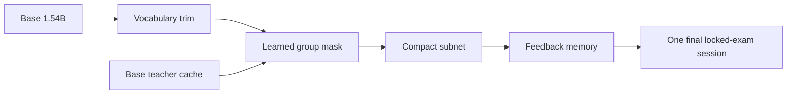

# Ten-percent Banking77 playbook

**Deliverable:** an executor's research and implementation guide, not a completed model or a claim of success. Only Markdown files are supplied here. Code names and commands below describe interfaces the executor must implement.

## Strategy

Start from the already trained, merged `johnsonfzzz/Qwen2.5-1.5B-Banking77-Intent` checkpoint at revision `6c13ee7e`. Trim its vocabulary, then learn a binary selection mask while keeping every retained source-model value bit-identical. Add a small, explicitly counted feedback memory to learn new intents without updating model weights.

**Bar:** on the locked exam, the higher accuracy of the unmodified base under (1) card-protocol greedy exact match and (2) valid-label-constrained greedy decoding. The card's reported 93.4% is context, not our measured bar.

**Claim A:** the frozen step-3 compact system scores **≥ the bar**. **Claim B:** after the full feedback stream it still scores **≥ the bar** and learns the new intents. Evaluate both frozen states in the same final exam session. A confidence interval or a −1.0 percentage-point non-inferiority result never substitutes for the strict headline.

**Size:** at most **154,371,430 retained numeric entries**, including norms, biases, and memory numbers, in both states. Aim for **152,800,000 source-model entries** to reserve space for memory. Separately try to package the entire inference artifact in **308,746,714 bytes**. Report parameter and byte results independently.

## File index

| Read | Purpose |
|---|---|
| [01_rules_claims_size.md](01_rules_claims_size.md) | Rule interpretation, claims, accounting, prohibitions |
| [02_setup_data_locked_exam.md](02_setup_data_locked_exam.md) | Pinned sources, environment, deterministic splits, lock |
| [03_baseline_harness.md](03_baseline_harness.md) | Prompt, decoding, metrics, isolation and sanity checks |
| [04_mask_search.md](04_mask_search.md) | Vocabulary fallback, mask search, loss, memory budget |
| [05_feedback_memory.md](05_feedback_memory.md) | Streaming corrections and 12 genuinely new intents |
| [06_packaging_verification_submission.md](06_packaging_verification_submission.md) | Standalone package, lineage proof, final evaluation |
| [07_schedule_gates_fallbacks.md](07_schedule_gates_fallbacks.md) | Relative-day gates, fallback ladder, risks |
| [08_references.md](08_references.md) | Verified sources, contributions, limits of evidence |
| [PREREGISTRATION_TEMPLATE.md](PREREGISTRATION_TEMPLATE.md) | Prespecified choices plus fields to complete before search |
| [EXECUTOR_PROMPT.md](EXECUTOR_PROMPT.md) | Copy-paste implementation handoff |

## Executor workflow

Read 01–03, fill the preregistration, and publish its commitment before mask search. Implement and test the harness before spending compute. Work through 04–06 using the pass/fail gates in 07; record every candidate and rejection. Do not open the exam to debug, build vocabulary, tune feedback, or choose a winner.

Use **Day 1 through Day 7**, relative to starting execution. Calendar deadlines and timestamps are not scheduling constraints. The fixed seed `20261106` is an identifier, not a deadline.

This is a high-risk experiment. Neither the literature nor these docs establish parity at 10% size. The vocabulary size, GPU fit, compression ratio, and final scores must be measured. If parity fails, publish the accuracy–size curve without a winning claim.

The executor may publish to its own explicitly designated public repository as authorized in the handoff. Contacting the organizer, posting on X, opening a challenge issue/PR, spending money, or using another owner's repository needs separate approval. No external writes are performed by this docs build.
